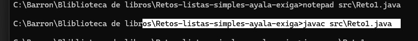
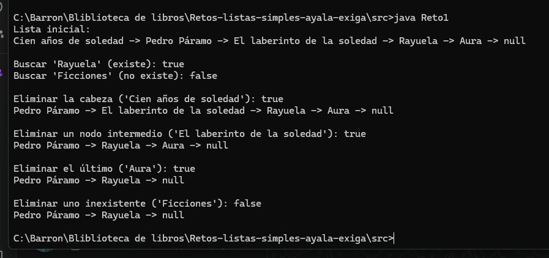
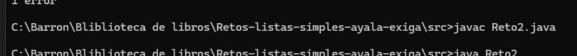
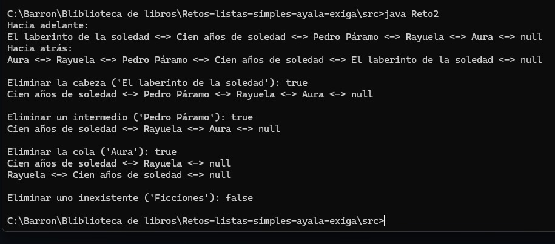
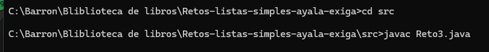
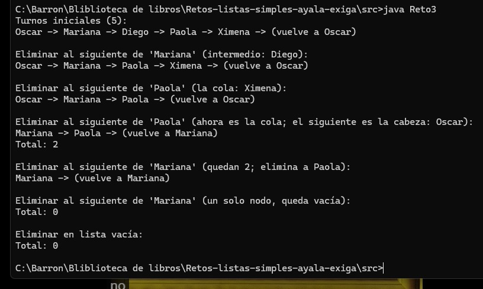

# Retos-listas-simples-ayala-exiga
Version A: Bliblioteca de libros

# Retos con listas simples, dobles y circulares

## Integrantes
- Oscar Manuel Ayala Ortiz
- Jesús Manuel Hernández Exiga

## Datos de la actividad
- *Asignatura:* Estructuras de datos
- *Docente:* Gabriel Barrón Rodríguez
- *Fecha:* 22 de octubre de 2026
- *Versión asignada:* A (Biblioteca de libros)
- *Lenguaje:* Java, compilado y ejecutado por consola

## Conceptos aprendidos

*Lista simple.* Cada nodo guarda un dato y una referencia al nodo siguiente. Solo se puede avanzar en un sentido, desde la cabeza hasta null. Ocupa poca memoria y es fácil de implementar, pero insertar al final obliga a recorrer toda la lista y para borrar un nodo hay que ubicar primero al que lo antecede. Sirve para estructuras que se recorren una sola vez en orden, como un catálogo o una pila de pendientes.

*Lista doble.* Cada nodo guarda, además del siguiente, una referencia al anterior. Con eso se puede recorrer en ambos sentidos y eliminar un nodo conocido sin buscar a su antecesor. El costo es más memoria y más enlaces que mantener: si se olvida actualizar uno, la lista queda inconsistente. Un ejemplo real es el historial de un navegador, donde se avanza y se retrocede entre páginas.

*Lista circular.* El último nodo apunta de nuevo al primero, así que nunca aparece null al final. Es ideal para procesos que se repiten, como los turnos de una fila o una lista de reproducción en bucle. Su riesgo principal es el ciclo infinito: hay que recorrerla con do { ... } while (actual != cabeza) y no con una condición de null.

*Encapsulamiento.* En los tres retos los atributos de nodos y listas son private. Los nodos se manipulan con getters y setters, y la cabeza y la cola solo se modifican desde los métodos de la propia lista. Así, ningún código externo puede romper los enlaces por accidente.

## Reto 1: Lista simple (Catálogo de libros)

*Qué se pidió:* completar insertarFinal, buscar y eliminar, y probarlos en el main con libros propios.

- *TODO 1:* si la lista está vacía, la cabeza pasa a ser el nodo nuevo.
- *TODO 2:* el ciclo avanza mientras actual.getSiguiente() != null, para detenerse en el último nodo y no pasarse a null.
- *TODO 3:* se enlaza el nuevo nodo con actual.setSiguiente(nuevo).
- *TODO 4:* buscar compara con equals, porque == compara referencias y no el contenido de los textos, y retorna true al encontrar el libro.
- *TODO 5:* para eliminar la cabeza basta con mover cabeza al siguiente nodo.
- *TODO 6:* se revisa si el título del nodo siguiente es el buscado, ya que para borrar hace falta estar parado en el nodo anterior.
- *TODO 7:* se salta el nodo con actual.setSiguiente(actual.getSiguiente().getSiguiente()). Esta misma línea sirve para borrar el último nodo.

*Pruebas:* se agregaron cinco libros propios, se buscó uno existente y otro inexistente, y se eliminó la cabeza, un nodo intermedio y el último.

## Reto 2: Lista doble (Historial de lectura)

*Qué se pidió:* completar insertarInicio, eliminar y el recorrido inverso.

- *TODO 1:* en lista vacía, cabeza y cola apuntan al nodo nuevo.
- *TODO 2:* el nuevo nodo apunta con siguiente a la cabeza actual.
- *TODO 3:* la cabeza actual apunta con anterior al nuevo nodo.
- *TODO 4:* la cabeza se actualiza al nuevo nodo.
- *TODO 5:* si el nodo a borrar tiene anterior, anterior.siguiente salta a actual.siguiente. Si no tiene, era la cabeza y esta pasa al siguiente.
- *TODO 6:* si tiene siguiente, siguiente.anterior salta a actual.anterior. Si no tiene, era la cola y esta retrocede al anterior.
- *TODO 7:* mostrarInverso imprime el dato y retrocede con getAnterior() desde la cola hasta null.

*Pruebas:* se insertaron cinco libros, se recorrió la lista en ambos sentidos y se eliminó la cabeza, un nodo intermedio, la cola y un libro que no existe.

## Reto 3: Lista circular (Turnos de préstamo)

*Qué se pidió:* completar insertar, mostrarUnaVuelta, contar y eliminarSiguienteDe.

- *TODO 1:* con un solo nodo, su siguiente apunta a sí mismo, y cabeza y cola son ese nodo.
- *TODO 2:* la cola actual se enlaza con el nuevo nodo.
- *TODO 3:* el nuevo nodo apunta a la cabeza para cerrar el círculo y pasa a ser la cola.
- *TODO 4:* dentro del do-while se avanza con actual = actual.getSiguiente().
- *TODO 5:* la condición es actual != cabeza, que detiene el recorrido al completar una vuelta.
- *TODO 6:* contar usa el mismo do-while, suma uno por nodo y devuelve 0 si la lista está vacía.
- *TODO 7:* se ubica al estudiante dando como máximo una vuelta y se salta al nodo siguiente. Se contemplan los casos de lista vacía, estudiante no encontrado, un solo nodo (la lista queda vacía), eliminado igual a la cabeza (la cabeza avanza) y eliminado igual a la cola (la cola retrocede).

*Pruebas:* se agregaron cinco estudiantes y se eliminó un turno intermedio, la cola y la cabeza, hasta dejar un solo nodo y después la lista vacía.

## Reflexión final

*1. ¿Qué punteros tuvieron que actualizar en la eliminación de una lista doble y por qué son más que en la simple?*

En la lista simple, borrar un nodo intermedio se resuelve con un solo enlace: el nodo anterior salta al siguiente del que se elimina. En la doble cada conexión existe en dos sentidos, así que además hay que corregir el puntero anterior del nodo que queda después. Es decir, el vecino izquierdo debe apuntar hacia adelante al vecino derecho, y el derecho debe apuntar hacia atrás al izquierdo. Si solo se arregla uno de los dos, la lista funciona al recorrerla en un sentido y falla al recorrerla en el otro. Cuando el nodo es la cabeza o la cola, además hay que mover esas referencias. Los enlaces extra son el precio de poder borrar un nodo sin volver a recorrer la lista para encontrar a su antecesor.

*2. ¿Qué error cometieron (o evitaron) por no considerar el caso de lista vacía o de un solo nodo?*

[Completen con su experiencia real. Ejemplo de estructura: qué error les marcó el compilador o el programa, en qué método ocurrió y cómo lo corrigieron. Si no tuvieron ninguno, expliquen qué caso evitaron al pensarlo antes de programar.]

Lo que sí podemos explicar del código es qué habría pasado. En eliminarSiguienteDe de la lista circular, si no se revisara el caso de un solo nodo, el nodo se apuntaría a sí mismo y la lista nunca quedaría vacía: cabeza y cola seguirían señalando a un nodo que se supone eliminado. En insertarFinal de la lista simple, olvidar la lista vacía provocaría un NullPointerException al intentar leer cabeza.getSiguiente(). Por eso cada método empieza revisando esos casos.

*3. ¿Qué pasaría si en la lista circular se recorre con while (actual != null)?*

El programa nunca terminaría. En una lista circular ningún nodo tiene siguiente igual a null, porque el último apunta a la cabeza. La condición siempre sería verdadera y el ciclo daría vueltas sin parar, imprimiendo los mismos elementos hasta que se interrumpa a mano o se agote algún recurso. Por eso se usa do { ... } while (actual != cabeza): la condición compara contra el punto de partida y corta el recorrido cuando se completó una vuelta. Se usa do-while y no while porque el primer nodo debe procesarse antes de comparar, ya que al inicio actual ya vale cabeza.

*4. ¿En qué situación elegirían cada tipo de lista?*

Una lista simple, cuando solo hace falta recorrer en un sentido y se quiere gastar poca memoria, por ejemplo un catálogo que se consulta de principio a fin. Una lista doble, cuando se necesita moverse hacia atrás o borrar nodos con frecuencia, como el historial de un navegador o la función de deshacer y rehacer de un editor. Una lista circular, cuando los elementos se repiten en ciclo: turnos de atención, rotación de procesos en un sistema operativo o una lista de reproducción en bucle. La decisión depende de qué operaciones se harán más seguido y de cuánta memoria se pueda gastar en enlaces.

*5. ¿Qué fue lo más difícil y cómo lo resolvieron como bina?*

[Completen con su experiencia real: qué reto o TODO les costó más, cómo lo resolvieron (dibujar los nodos en papel, probar casos en consola, dividir los retos entre ambos) y cómo se repartieron el trabajo.]

## Cómo compilar y ejecutar

Desde la carpeta src:

cd src
javac Reto1.java
java Reto1
javac Reto2.java
java Reto2
javac Reto3.java
java Reto3
